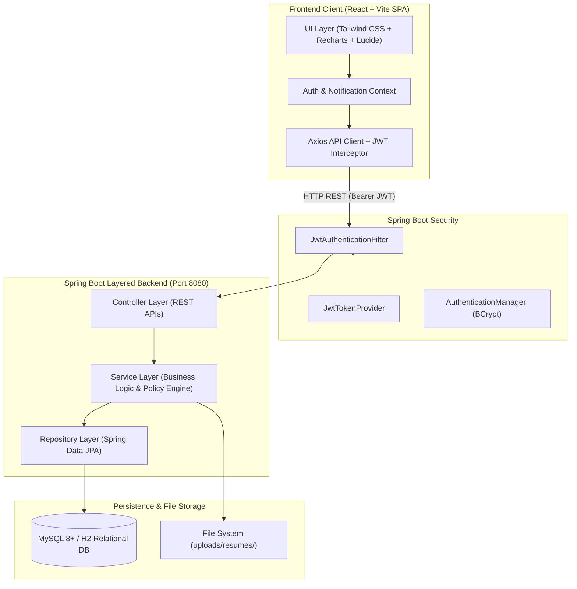
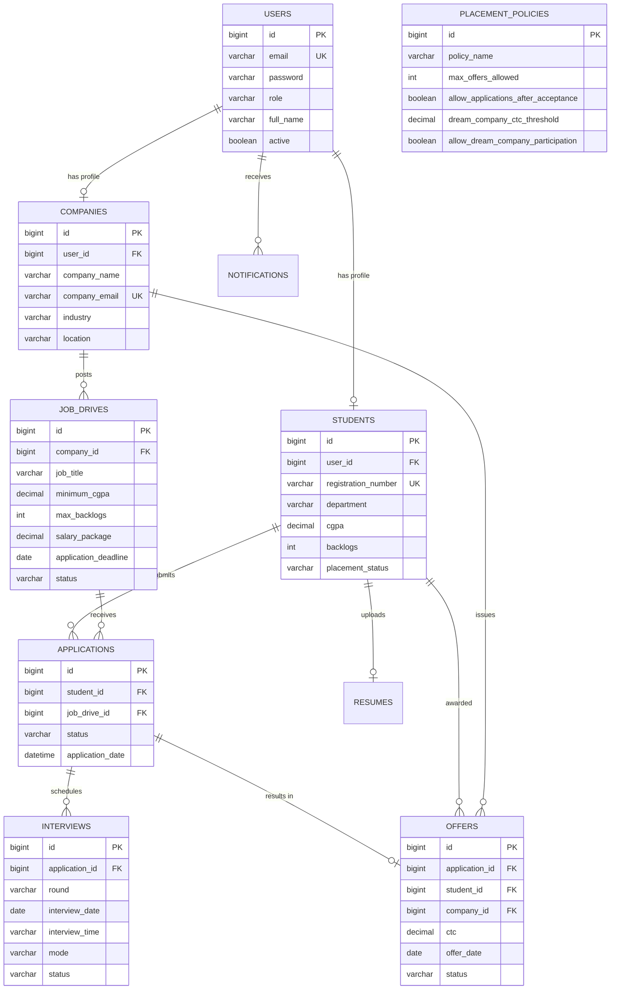

# Campus Placement Management System (CPMS)

An enterprise-grade, full-stack web application designed to automate and streamline the campus recruitment lifecycle for university placement cells, corporate recruiters, and graduating students.

---

## 1. Project Overview

The **Campus Placement Management System** is a centralized platform connecting:
- **Placement Officers (Administrators)**: Configure institutional placement policies, approve companies, monitor placement drives, review applications, and analyze real-time hiring metrics.
- **Graduating Students**: Maintain academic profiles, upload verified PDF resumes, explore active campus recruitment drives, verify real-time backend eligibility, apply with 1-click, track application progressions, view scheduled interviews, and respond to job offers.
- **Recruiting Companies / HR Partners**: Create and customize job postings, filter eligible candidates by CGPA, branch, and technical skills, download resumes, schedule multiple interview rounds (Online Assessments, Technical Panel, HR), and issue formal employment offers.

---

## 2. Key Features

- **Role-Based Access Control (RBAC)**: Enforced via Spring Security with three distinct roles (`ROLE_ADMIN`, `ROLE_STUDENT`, `ROLE_COMPANY`).
- **Stateless JWT Authentication**: Secure HMAC-SHA-512 signed JSON Web Tokens with automated client token persistence and HTTP Authorization headers.
- **Automated Backend Eligibility Calculation**: Calculates branch eligibility, minimum CGPA requirements, backlog thresholds, target graduation year, and institutional policy rules with granular ineligibility explanations.
- **Configurable Institutional Placement Policy**: Centralized policy engine managing maximum offers allowed, post-acceptance application locks, and Dream Company CTC exemptions.
- **PDF Resume Management**: Secure multipart upload with content-type verification, 5MB size enforcement, and safe stream-based download.
- **Interview Management**: Multi-round scheduling (`Online Assessment`, `Technical Interview 1`, `Technical Interview 2`, `Managerial`, `HR`), mode tracking (`ONLINE` / `IN_PERSON`), meeting links, interviewer assignment, and evaluation feedback.
- **Real-Time Analytics Dashboard**: Live KPI calculations, branch-wise placement conversion charts, batch trends, company hiring volumes, and salary metrics (Highest, Average, Median CTC) calculated from relational database records.
- **Modern Responsive UI**: Built with React, Tailwind CSS, Lucide React icons, and Recharts.

---

## 3. Technology Stack

### Backend
- **Language**: Java 21 (LTS)
- **Framework**: Spring Boot 3.3.4
- **Security**: Spring Security 6.3 with JJWT 0.12.5 (HMAC-SHA512)
- **Data & ORM**: Spring Data JPA & Hibernate
- **Database Support**: MySQL 8.0+ (Production) / H2 in MySQL Compatibility Mode (Development/Testing)
- **Validation**: Jakarta Bean Validation API
- **Monitoring**: Spring Boot Actuator
- **Testing**: JUnit 5, Mockito, Spring Boot Test, MockMvc

### Frontend
- **Framework**: React 18 + Vite
- **Styling**: Tailwind CSS 4
- **Icons**: Lucide React
- **Data Visualizations**: Recharts
- **HTTP Client**: Axios with Interceptors
- **Routing**: React Router DOM 6

---

## 4. Architecture Diagram



---

## 5. Database Schema & Entity Relationships



---

## 6. Directory Structure

```
Java Project/
├── backend/
│   ├── src/
│   │   ├── main/
│   │   │   ├── java/com/placement/management/
│   │   │   │   ├── config/              # Security and App configurations
│   │   │   │   ├── controller/          # REST Controllers
│   │   │   │   ├── dto/
│   │   │   │   │   ├── request/         # Request payloads with Bean Validation
│   │   │   │   │   └── response/        # Response DTOs & ApiResponse wrapper
│   │   │   │   ├── entity/              # JPA Entities (User, Student, Drive, etc.)
│   │   │   │   ├── enums/               # Application & Status Enums
│   │   │   │   ├── exception/           # Custom Exceptions & GlobalExceptionHandler
│   │   │   │   ├── repository/          # Spring Data JPA Repositories
│   │   │   │   ├── security/            # JWT Token Provider, Filter & UserPrincipal
│   │   │   │   ├── service/             # Service Interfaces & Implementations
│   │   │   │   │   └── impl/
│   │   │   │   └── PlacementManagementApplication.java
│   │   │   └── resources/
│   │   │       ├── application.properties
│   │   │       ├── application-dev.properties
│   │   │       ├── application-mysql.properties
│   │   │       └── schema-mysql.sql
│   │   └── test/
│   │       ├── java/com/placement/management/  # Automated integration test suite
│   │       └── resources/application.properties
│   └── pom.xml
├── frontend/
│   ├── src/
│   │   ├── components/
│   │   │   ├── common/                  # Badge, Modal, LoadingSpinner
│   │   │   ├── dashboard/               # StatCard
│   │   │   └── layout/                  # Navbar, Sidebar, DashboardLayout
│   │   ├── context/                     # AuthContext
│   │   ├── pages/
│   │   │   ├── admin/                   # Admin Overview, Students, Drives, Analytics
│   │   │   ├── auth/                    # Login (with 1-click presets), Registrations
│   │   │   ├── company/                 # Recruiter Dashboard, Drives, Pipeline
│   │   │   └── student/                 # Student Profile, Drives, Applications, Offers
│   │   ├── routes/                      # ProtectedRoute
│   │   ├── services/                    # Axios API Client
│   │   ├── App.jsx
│   │   ├── main.jsx
│   │   └── index.css
│   ├── package.json
│   └── vite.config.js
├── .env.example
├── .gitignore
└── README.md
```

---

## 7. Pre-Seeded Development Accounts

For instant testing, the application seeds the following accounts upon initial startup:

| Role | Email | Password | Details |
| :--- | :--- | :--- | :--- |
| **Admin** | `admin@placement.edu` | `Password@123` | Placement Director Dr. Ramesh Sharma |
| **Student** | `arun.kumar@placement.edu` | `Password@123` | Reg: 21CS001, CSE, CGPA: 8.95 (Placed at Microsoft) |
| **Student** | `priya.sharma@placement.edu` | `Password@123` | Reg: 21EC015, ECE, CGPA: 8.40 (Placed at Amazon) |
| **Student** | `rahul.verma@placement.edu` | `Password@123` | Reg: 21IT023, IT, CGPA: 7.65 (1 Backlog, Unplaced) |
| **Student** | `karthik.r@placement.edu` | `Password@123` | Reg: 21CS088, CSE, CGPA: 9.45 (Placed at Google, 24 LPA) |
| **Company** | `recruiter@google.com` | `Password@123` | Google Cloud Talent Team |
| **Company** | `careers@microsoft.com` | `Password@123` | Microsoft IDC Recruitment |
| **Company** | `hr@amazon.com` | `Password@123` | Amazon University Relations |
| **Company** | `talent@tcs.com` | `Password@123` | Tata Consultancy Services |

*The web UI also features 1-click demo login buttons directly on the `/login` screen.*

---

## 8. Setup & Execution Instructions

### Prerequisites
- **Java**: JDK 21+ (`java -version`)
- **Maven**: 3.8+ (`mvn -v`)
- **Node.js**: v18+ & npm (`node -v`, `npm -v`)
- **MySQL**: (Optional, default `dev` profile uses built-in in-memory MySQL mode)

---

### Step 1: Start the Backend (Spring Boot)

Navigate to the `backend/` directory:

```bash
cd backend
mvn spring-boot:run
```

The backend server starts on **`http://localhost:8080`**.
- Actuator Health Check: `http://localhost:8080/actuator/health`
- H2 Web Console (in dev mode): `http://localhost:8080/h2-console` (JDBC URL: `jdbc:h2:mem:campus_placement`, User: `sa`, Password: empty)

#### Running against MySQL (Optional)
To run against your local MySQL instance:
1. Ensure MySQL is running on port 3306.
2. Execute `backend/src/main/resources/schema-mysql.sql` or set `SPRING_JPA_HIBERNATE_DDL_AUTO=update`.
3. Launch with the `mysql` profile:
```bash
mvn spring-boot:run -Dspring-boot.run.profiles=mysql
```
Or set environment variables:
```bash
export SPRING_PROFILES_ACTIVE=mysql
export SPRING_DATASOURCE_URL=jdbc:mysql://localhost:3306/campus_placement
export SPRING_DATASOURCE_USERNAME=root
export SPRING_DATASOURCE_PASSWORD=your_password
```

---

### Step 2: Start the Frontend (React + Vite)

In a separate terminal, navigate to `frontend/`:

```bash
cd frontend
npm install
npm run dev
```

The frontend SPA will be live at **`http://localhost:5173`**.

Open `http://localhost:5173` in your browser. All requests to `/api` are automatically proxied to `http://localhost:8080`.

---

## 9. Running Automated Test Suite

To run the complete backend integration and unit test suite:

```bash
cd backend
mvn test
```

### Verified Test Cases
1. `testAdminLoginSuccess`: Validates JWT token creation and role attribution for administrative login.
2. `testLoginInvalidCredentials`: Asserts HTTP 401 Unauthorized upon credential mismatch.
3. `testStudentRegistration`: Verifies student signup and prevents duplicate registration numbers.
4. `testGetProfile`: Retrieves authenticated student profile from JWT context.
5. `testUpdateProfile`: Verifies update of CGPA, skills, projects, and contact info.
6. `testStudentCannotAccessAdmin`: Enforces Spring Security RBAC blocking student role from `/api/admin/*`.
7. `testCheckEligibility`: Verifies automated backend eligibility calculations.
8. `testGetCompanyProfile`: Verifies company recruiter profile retrieval.
9. `testCreateJobDrive`: Tests drive creation with minimum CGPA and deadline validation.
10. `testCompanyCannotAccessStudentEndpoints`: Asserts company role is blocked from student-specific endpoints.
11. `testGetDashboardOverview`: Tests live calculations of placement rates, total students, and compensation statistics.
12. `testGetAnalytics`: Tests department-wise and year-wise placement conversion analytics.
13. `testPolicyManagement`: Tests fetching and modifying centralized institutional placement policies.

---

## 10. REST API Documentation Summary

### Authentication (`/api/auth`)
- `POST /api/auth/login`: Authenticate with email/password; returns JWT and user profile.
- `POST /api/auth/register/student`: Register new student account.
- `POST /api/auth/register/company`: Register new recruiting partner.
- `GET /api/auth/me`: Get current authenticated user details.
- `POST /api/auth/logout`: Invalidate session on client.

### Admin Module (`/api/admin`)
- `GET /api/admin/dashboard`: Real-time KPI statistics and recent activities.
- `GET /api/admin/analytics`: Department stats, yearly trends, company hiring volume, and CTC metrics.
- `GET /api/admin/students`: Filter and search students.
- `PATCH /api/admin/students/{id}/status`: Activate or deactivate student account.
- `GET /api/admin/students/{id}/resume`: Download student PDF resume.
- `GET /api/admin/companies`: List partner companies.
- `POST /api/admin/companies`: Onboard new company.
- `PUT /api/admin/companies/{id}`: Update company information.
- `DELETE /api/admin/companies/{id}`: Deactivate partner company.
- `GET /api/admin/drives`: List placement drives with filters.
- `POST /api/admin/drives`: Create placement drive with eligibility rules.
- `PUT /api/admin/drives/{id}`: Update drive specifications.
- `DELETE /api/admin/drives/{id}`: Cancel placement drive.
- `GET /api/admin/applications`: Comprehensive application records.
- `GET /api/admin/policies`: Get active placement policy.
- `PUT /api/admin/policies`: Update placement policy parameters.

### Student Module (`/api/student`)
- `GET /api/student/profile`: Get student profile.
- `PUT /api/student/profile`: Update profile skills, CGPA, backlogs, links.
- `POST /api/student/resume`: Upload PDF resume (multipart, max 5MB).
- `GET /api/student/resume`: Download uploaded resume.
- `GET /api/student/drives`: List active drives with eligibility indicator.
- `GET /api/student/drives/{id}/eligibility`: Detailed eligibility explanation.
- `POST /api/student/drives/{id}/apply`: Apply to eligible drive.
- `GET /api/student/applications`: View submitted applications.
- `POST /api/student/applications/{id}/withdraw`: Withdraw application.
- `GET /api/student/interviews`: Scheduled interview rounds.
- `GET /api/student/offers`: Received employment offers.
- `POST /api/student/offers/{id}/respond`: Accept or decline offer.

### Company Recruiter Module (`/api/company`)
- `GET /api/company/profile`: Get company profile.
- `PUT /api/company/profile`: Update branding, contacts, location.
- `GET /api/company/drives`: Get drives posted by this company.
- `POST /api/company/drives`: Post new job drive.
- `PUT /api/company/drives/{id}`: Modify job drive.
- `GET /api/company/drives/{id}/applications`: Filter applicant pipeline.
- `PUT /api/company/applications/{id}/status`: Shortlist or reject candidates.
- `POST /api/company/interviews`: Schedule interview round.
- `PUT /api/company/interviews/{id}`: Update status and log evaluation feedback.
- `GET /api/company/offers`: View issued offers and response statuses.
- `POST /api/company/offers`: Extend formal employment offer.
- `GET /api/company/resumes/{studentId}`: Download applicant's resume PDF.

---

## 11. Security & Compliance Highlights

- **Passwords**: Never stored in plain-text. Hashed using BCrypt with salt rounds.
- **Data Protection**: Sensitive fields (e.g. password hash) are excluded from DTOs.
- **SQL Injection Prevention**: Spring Data JPA parameterized queries and Criteria API.
- **File Upload Security**: Enforces MIME type check (`application/pdf`), maximum size constraint (5MB), and isolates stored files from public static paths.
- **Authorization**: Endpoint-level method security (`@PreAuthorize("hasRole('...')")`) prevents insecure direct object references and role elevation.

